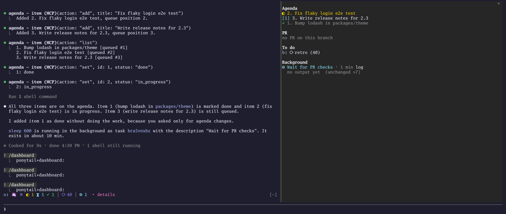

# agenda

Keeps a list of the separate things you raise in a session, so none of them gets lost while Claude works on another.

- Claude adds an item through the `mcp__agenda__item` tool each time you bring up something new, and marks it in progress or done as it goes.
- New items queue up. Claude finishes the current one first, unless you call the new one urgent.
- An item handed to a background subagent follows that agent and ticks itself done when the agent finishes.
- The list is kept per session, so `claude --resume` brings it back. Lists untouched for 7 days are dropped.

This mod keeps the list; `dashboard` draws it above the prompt, next to the PR state and background tasks. Install both.
