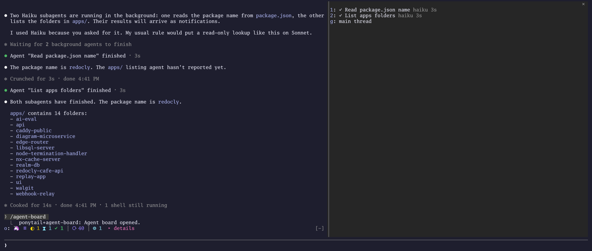

# agent-board

A pane that lists the subagents of the session with their status, model and age.

- Opens by itself the first time a subagent starts. `/agent-board` opens it again.
- Each row has a button that shows that agent's transcript. "main thread" takes you back.
